# 🏥 SMART HOSPITAL BEDSIDE SYSTEM - HARDWARE WIRING & CONNECTION GUIDE

This document provides a **complete, foolproof, step-by-step wiring guide** for connecting all sensors and display modules to your **ESP32 NodeMCU (30-pin)** board.

---

## 📌 1. Comprehensive Master Pinout Table

| Component | Component Pin Name | ESP32 Pin | Power Voltage | Wire Type / Special Notes |
| :--- | :--- | :--- | :--- | :--- |
| **MAX30102** (Pulse Oximeter) | **VIN / VCC** | **3V3** (or VIN) | 3.3V | Red wire |
| | **GND** | **GND** | 0V | Black wire |
| | **SDA** | **GPIO 21** | Logic | Standard I2C Data |
| | **SCL** | **GPIO 22** | Logic | Standard I2C Clock |
| | *INT / IRQ* | *Not Connected* | - | Leave Unconnected |
| **DS18B20** (Body Temperature) | **VCC / Red** | **3V3** | 3.3V | Red wire |
| | **GND / Black** | **GND** | 0V | Black wire |
| | **DATA / Yellow or Green** | **GPIO 4** | Logic | Electrobot module has onboard 4.7kΩ pull-up |
| **SEN18** (Saline Level Sensor) | **+ / VCC** | **3V3** | 3.3V | Red wire |
| | **- / GND** | **GND** | 0V | Black wire |
| | **S / Signal** | **GPIO 34** | Analog In | ADC1 Input (Safe, non-attenuated) |
| **Active Buzzer** (Medical Alarm) | **+ (Long leg / labeled +)**| **GPIO 25** | Logic | Direct GPIO drive |
| | **- (Short leg / labeled -)**| **GND** | 0V | Black wire |
| **Nurse SOS Button / Wire** | **Single Bare Wire** | **GPIO 13** | Touch | Built-in ESP32 capacitive touch sensor |
| **Alarm Snooze Button** | **Built-in BOOT Button** | **GPIO 0** | Internal | Already mounted on ESP32 board! |
| **16x2 LCD** (SixOhms 16-pin) | **Pin 1 (VSS)** | **GND** | 0V | Power Ground |
| | **Pin 2 (VDD)** | **VIN (5V)** | 5V | LCD Logic Power |
| | **Pin 3 (V0)** | **Potentiometer Middle** | 0-5V | Contrast pin (Wiper of 10kΩ Pot) |
| | **Pin 4 (RS)** | **GPIO 19** | Logic | Register Select |
| | **Pin 5 (RW)** | **GND** | 0V | Grounded for Write mode |
| | **Pin 6 (EN)** | **GPIO 18** | Logic | Enable Strobe |
| | **Pin 7-10 (D0-D3)**| *Leave Unconnected* | - | 4-bit mode doesn't use D0-D3 |
| | **Pin 11 (D4)** | **GPIO 5** | Logic | Data line 4 |
| | **Pin 12 (D5)** | **GPIO 17** | Logic | Data line 5 |
| | **Pin 13 (D6)** | **GPIO 16** | Logic | Data line 6 |
| | **Pin 14 (D7)** | **GPIO 15** | Logic | Data line 7 |
| | **Pin 15 (A / BLA)** | **VIN (5V) via 220Ω** | 5V | Backlight Anode (+) |
| | **Pin 16 (K / BLK)** | **GND** | 0V | Backlight Cathode (-) |

---

## 🎨 2. Visual Architecture & Wiring Schematic (Mermaid Diagram)

```mermaid
flowchart TD
    subgraph ESP32["ESP32 NodeMCU (30-Pin) Core Hub"]
        P3V3["3V3 (3.3V Rail)"]
        PVIN["VIN (5V Power Rail)"]
        PGND["GND (Common Ground)"]
        G21["GPIO 21 (SDA)"]
        G22["GPIO 22 (SCL)"]
        G4["GPIO 4 (OneWire)"]
        G34["GPIO 34 (ADC1)"]
        G25["GPIO 25 (DAC1 / Alarm)"]
        G13["GPIO 13 (Capacitive Touch)"]
        G19["GPIO 19 (LCD RS)"]
        G18["GPIO 18 (LCD EN)"]
        G5["GPIO 5 (LCD D4)"]
        G17["GPIO 17 (LCD D5)"]
        G16["GPIO 16 (LCD D6)"]
        G15["GPIO 15 (LCD D7)"]
    end

    subgraph MAX["MAX30102 Pulse Oximeter"]
        MVIN["VCC"] --> P3V3
        MGND["GND"] --> PGND
        MSDA["SDA"] --> G21
        MSCL["SCL"] --> G22
    end

    subgraph TEMP["DS18B20 Temp Sensor"]
        TVCC["VCC (Red)"] --> P3V3
        TGND["GND (Black)"] --> PGND
        TDAT["DATA (Yellow)"] --> G4
    end

    subgraph SALINE["SEN18 Saline Drip Level Sensor"]
        SVCC["VCC (+)"] --> P3V3
        SGND["GND (-)"] --> PGND
        SSIG["SIG (S)"] --> G34
    end

    subgraph BUZZ["Active Alarm Buzzer"]
        BPOS["Positive (+)"] --> G25
        BNEG["Negative (-)"] --> PGND
    end

    subgraph SOS["Nurse Emergency Call"]
        STOUCH["Bare Wire End"] --> G13
    end

    subgraph LCD["16x2 Parallel LCD (JHD162A)"]
        L1["Pin 1 (VSS)"] --> PGND
        L2["Pin 2 (VDD)"] --> PVIN
        L4["Pin 4 (RS)"] --> G19
        L5["Pin 5 (RW)"] --> PGND
        L6["Pin 6 (EN)"] --> G18
        L11["Pin 11 (D4)"] --> G5
        L12["Pin 12 (D5)"] --> G17
        L13["Pin 13 (D6)"] --> G16
        L14["Pin 14 (D7)"] --> G15
        L15["Pin 15 (A)"] --> PVIN
        L16["Pin 16 (K)"] --> PGND
    end
```

---

## 🛠️ 3. Step-by-Step Connection Instructions

### Step 1: Connect Power & Common Ground Rails
1. Take your breadboard power rails:
   - Connect **ESP32 GND** to the breadboard **Blue/Negative (-) rail**.
   - Connect **ESP32 3V3** to the breadboard **Red/Positive (+) rail**.
   - Connect **ESP32 VIN (5V)** to a separate row for the LCD display power.

---

### Step 2: Connect MAX30102 (Pulse & SpO2 Sensor)
> **Fix for `"MAX30102 not detected. Check I2C wiring"` warning:**
1. Connect **VIN** on MAX30102 to **3V3** (Red rail).
2. Connect **GND** on MAX30102 to **GND** (Blue rail).
3. Connect **SDA** to **GPIO 21** of ESP32.
4. Connect **SCL** to **GPIO 22** of ESP32.
*(Leave INT unconnected).*

---

### Step 3: Connect DS18B20 (Body Temperature Sensor)
Your Electrobot DS18B20 module has 3 pins or a 3-wire probe:
1. Connect **VCC (Red wire)** to **3V3**.
2. Connect **GND (Black wire)** to **GND**.
3. Connect **DATA (Yellow/Green wire)** to **GPIO 4**.
*(The Electrobot module already has an onboard surface-mount 4.7kΩ pull-up resistor).*

---

### Step 4: Connect TekBud SEN18 (Saline Bottle Level Sensor)
1. Connect **+ (VCC)** to **3V3**.
2. Connect **- (GND)** to **GND**.
3. Connect **S (Signal)** to **GPIO 34**.
*(Place the sensor strip against your IV saline bottle or in a test cup of water).*

---

### Step 5: Connect Active Medical Buzzer
1. Connect the **Long leg (+)** of the buzzer to **GPIO 25**.
2. Connect the **Short leg (-)** of the buzzer to **GND**.

---

### Step 6: Connect Nurse Emergency Touch SOS
1. Take any male jumper wire.
2. Plug one end into **GPIO 13** on the ESP32.
3. Leave the other metal pin exposed like an antenna/touchpad. When the patient or nurse touches this bare pin with their finger, ESP32's capacitive hardware detects touch and rings the alarm!

---

### Step 7: Connect 16x2 LCD (SixOhms JHD162A 16-Pin)
Look at the LCD pin numbers (1 to 16, printed from left to right on the green PCB):

| LCD Pin Number | Label | Connect To |
| :---: | :---: | :--- |
| **Pin 1** | **VSS** | Breadboard **GND** |
| **Pin 2** | **VDD** | Breadboard **VIN (5V)** |
| **Pin 3** | **V0** | Middle pin of 10kΩ Potentiometer (or connect to GND for max contrast) |
| **Pin 4** | **RS** | **GPIO 19** |
| **Pin 5** | **RW** | Breadboard **GND** |
| **Pin 6** | **EN** | **GPIO 18** |
| **Pin 7 - 10** | **D0 - D3**| Leave disconnected (4-bit mode doesn't need them) |
| **Pin 11** | **D4** | **GPIO 5** |
| **Pin 12** | **D5** | **GPIO 17** |
| **Pin 13** | **D6** | **GPIO 16** |
| **Pin 14** | **D7** | **GPIO 15** |
| **Pin 15** | **A (LED+)**| **VIN (5V)** (through a 220Ω resistor or directly to 3.3V) |
| **Pin 16** | **K (LED-)**| Breadboard **GND** |

> **Contrast Tip:** If you see only solid black rectangles or a blank screen, rotate the potentiometer knob connected to Pin 3 until the characters appear crisp and sharp!

---

## 🧪 4. Live Verification & Testing Checklist

Once all wires are connected:
1. **Restart the ESP32:** Press the **EN / RST** button on the ESP32 board.
2. **Check LCD:** Text `APOLLO SMART HOSPITAL` followed by live vital parameters will start displaying.
3. **Silence Siren:** Place the SEN18 saline sensor into a cup of water (so Saline > 20%), and place your finger onto the MAX30102. The siren will stop!
4. **Snooze Test:** Press the onboard **BOOT** button (GPIO 0) — the siren immediately silences for 60 seconds.
5. **Touch SOS Test:** Tap the bare wire on **GPIO 13** — Siren rings immediately with Emergency SOS alert!
6. **Web Dashboard:** Connect your phone to Wi-Fi `Smart-Hospital-Bed04` (password: `hospital123`) and open `http://192.168.4.1` in Chrome to see live ECG and hear the audio voice alarms!
